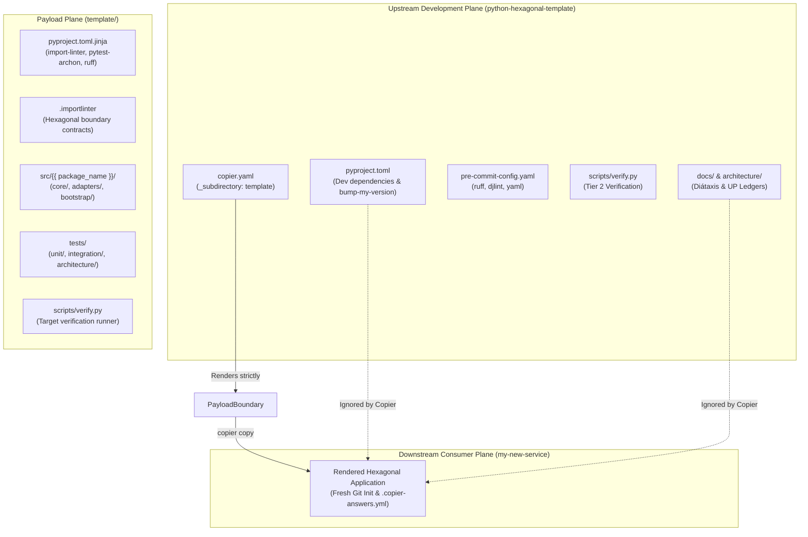
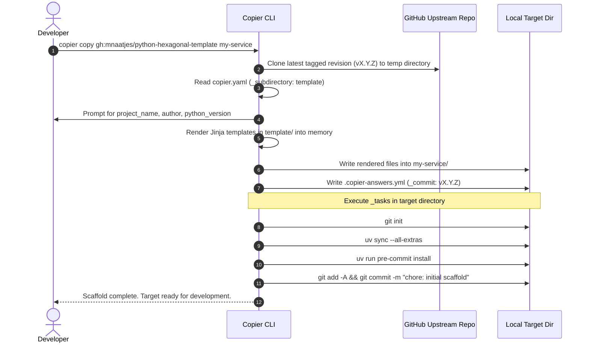
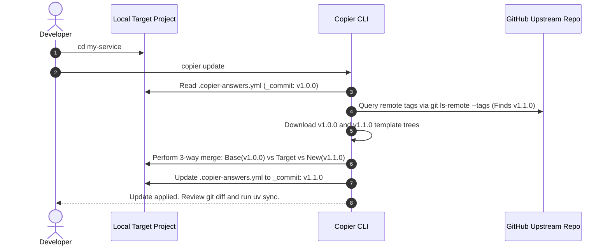

# SDD-0001: Copier Template Engine, Upstream Tooling Harness, and Verification Pipeline

## 1. Architectural Context & System Objectives

### 1.1 The Skeptic Test (Justification)
Why build a custom template harness when GitHub provides native "Template Repositories"?
* **Zero Lifecycle Drift Control:** Standard GitHub templates perform a one-time copy of the repository root. Once downstream repositories diverge, there is zero mechanism to push updated architectural linter contracts (`.importlinter`), AST rule updates, or testing gates into existing services.
* **Meta-Ledger Contamination:** Standard template repositories copy the authoring team's development history, ADRs, risk registers, and bump-version scripts into every downstream project.
* **Copier Solution:** Adopting Copier with an explicit `_subdirectory: template` payload boundary enables clean separation between the template's own Unified Process engineering ledger and the pristine downstream skeleton, while native Git tag tracking enables 3-way non-destructive updates (`copier update`).

### 1.2 The Vacation Test (Autonomy Specification)
This document provides complete, unabridged technical specifications for:
1. Configuring the Upstream manifest (`pyproject.toml`) and virtual environment (`.venv/`).
2. Authoring `copier.yaml` with strict prompts, derived variables, and post-generation lifecycle tasks.
3. Implementing the Upstream quality gate (`.pre-commit-config.yaml`) and verification runner (`scripts/verify.py`).
4. Writing automated template instantiation unit tests using `pytest` and `pytest-copie`.
Any software engineer can implement, verify, and release `v0.1.0` of this repository using strictly the specifications below.

---

## 2. Static Architectural Structure

### 2.1 Component Boundary Model



### 2.2 Directory Topology & Boundary Mappings

```text
python-hexagonal-template/
├── pyproject.toml                     # Static Upstream manifest
├── copier.yaml                        # Copier configuration (_subdirectory: template)
├── .pre-commit-config.yaml            # Upstream quality gates (ruff, djlint, yaml)
├── scripts/
│   ├── verify.py                      # Upstream 4-stage verification runner
│   └── bump_version.py                # Version helper wrapper
├── architecture/                      # Upstream Unified Process engineering ledger
│   ├── adr/
│   └── designs/
├── docs/                              # Diátaxis operator manuals
│   └── how-to/
│       └── instantiate_hexagonal_project.md
│
└── template/                          # THE PAYLOAD PLANE (Only this renders downstream)
    ├── .copier-answers.yml.jinja      # Copier state receipt
    ├── .gitignore.jinja               # Target gitignore
    ├── .importlinter                  # Deterministic boundary rules
    ├── pyproject.toml.jinja           # Rendered downstream package manifest
    ├── README.md.jinja                # Downstream service README
    ├── src/
    │   └── {{ package_name }}/
    │       ├── core/
    │       │   ├── domain/
    │       │   └── ports/
    │       │       ├── driving/
    │       │       └── driven/
    │       ├── adapters/
    │       │   ├── driving/
    │       │   └── driven/
    │       └── bootstrap/
    ├── tests/
    └── scripts/
        └── verify.py
```

---

## 3. Dynamic Execution & Lifecycle Flows

### 3.1 Instantiation Sequence (`copier copy`)



### 3.2 Update Synchronization Sequence (`copier update`)



---

## 4. Implementation Specifications

### 4.1 Upstream `pyproject.toml`
The root `pyproject.toml` must be populated exactly as follows:

```toml
[project]
name = "python-hexagonal-template"
version = "0.1.0"
description = "Production-grade Copier template for Python Hexagonal Architecture"
readme = "README.md"
requires-python = ">=3.12"
dependencies = []

[project.optional-dependencies]
dev = [
    "copier>=9.0.0",
    "bump-my-version>=0.28.0",
    "pytest>=8.0.0",
    "pytest-copie>=0.2.0",
    "ruff>=0.7.3",
    "mypy>=1.13.0",
    "djlint>=1.35.2",
    "pymarkdownlnt>=0.1.15",
    "pre-commit>=4.0.0",
]

[tool.bumpversion]
current_version = "0.1.0"
commit = true
tag = true
tag_name = "v{new_version}"
commit_message = "chore(release): bump version to {new_version}"

[[tool.bumpversion.files]]
filename = "pyproject.toml"
search = 'version = "{current_version}"'
replace = 'version = "{new_version}"'

[tool.ruff]
line-length = 100
target-version = "py312"

[tool.ruff.lint]
select = ["E", "F", "W", "I", "B", "UP"]

[tool.djlint]
profile = "jinja"
extension = "jinja"
indent = 4
max_line_length = 100
preserve_blank_lines = true

[tool.pytest.ini_options]
testpaths = ["tests"]
```

### 4.2 Root `copier.yaml`
```yaml
_subdirectory: template
_min_copier_version: "9.0.0"
_answers_file: ".copier-answers.yml"

project_name:
  type: str
  help: "Human-readable name of the application (e.g., 'Order Management Service')"
  default: "Hexagonal Service"

project_slug:
  type: str
  default: "{{ project_name | lower | replace(' ', '-') | replace('_', '-') }}"

package_name:
  type: str
  default: "{{ project_name | lower | replace(' ', '_') | replace('-', '_') }}"

project_description:
  type: str
  help: "Brief description of the bounded context"
  default: "Hexagonally architected service"

author_name:
  type: str
  default: "Engineering Team"

author_email:
  type: str
  default: "engineering@example.com"

python_version:
  type: str
  default: "3.12"
  choices:
    - "3.12"
    - "3.13"

include_architecture_governance:
  type: bool
  default: true
  help: "Include baseline architecture/ directory and starter ADRs in downstream project"

_tasks:
  - "git init"
  - "uv sync --all-extras"
  - "uv run pre-commit install"
  - "git add -A"
  - "git commit -m 'chore: initial project scaffold via python-hexagonal-template'"
```

### 4.3 Upstream `.pre-commit-config.yaml`
```yaml
repos:
  - repo: https://github.com/pre-commit/pre-commit-hooks
    rev: v5.0.0
    hooks:
      - id: trailing-whitespace
      - id: end-of-file-fixer
      - id: check-yaml
        exclude: ^copier\.yaml$
      - id: check-toml

  - repo: https://github.com/astral-sh/ruff-pre-commit
    rev: v0.7.3
    hooks:
      - id: ruff
        args: [--fix]
      - id: ruff-format

  - repo: https://github.com/Riverside-Healthcare/djLint
    rev: v1.35.2
    hooks:
      - id: djlint-reformat-jinja
        files: ^template/.*\.jinja$
      - id: djlint-jinja
        files: ^template/.*\.jinja$
```

### 4.4 Upstream Deterministic Verification Runner (`scripts/verify.py`)
A standalone Python script executing Tier 2 checks:
```python
#!/usr/bin/env python3
"""Upstream Quality Verification Runner for python-hexagonal-template."""
import subprocess
import sys

CHECKS = [
    ("Pre-commit hooks", ["uv", "run", "pre-commit", "run", "--all-files"]),
    ("Jinja formatting & lint", ["uv", "run", "djlint", "template/", "--check"]),
    ("Unit and template tests", ["uv", "run", "pytest", "tests/"]),
]

def run_checks() -> int:
    for name, cmd in CHECKS:
        print(f"\n[RUNNING] {name}...")
        res = subprocess.run(cmd)
        if res.returncode != 0:
            print(f"[FAILED] {name}")
            return res.returncode
        print(f"[PASSED] {name}")
    print("\nAll Upstream Quality Gates Passed.")
    return 0

if __name__ == "__main__":
    sys.exit(run_checks())
```

---

## 5. Phased Implementation Plan

The implementation is broken into 4 sequential checklist phases:

### Phase 1: Upstream Manifests & Quality Tooling
- [ ] Populate `pyproject.toml` with dev dependencies, bumpversion, ruff, djlint, and pytest configs.
- [ ] Populate `copier.yaml` with `_subdirectory: template`, prompts, and lifecycle `_tasks`.
- [ ] Populate `.pre-commit-config.yaml`.
- [ ] Implement `scripts/verify.py` and set executable permissions.

### Phase 2: Environment Bootstrap & Pre-commit Installation
- [ ] Initialize upstream virtual environment: `uv sync`.
- [ ] Install pre-commit hooks: `uv run pre-commit install`.
- [ ] Verify clean baseline execution: `uv run python scripts/verify.py`.

### Phase 3: Automated Template Instantiation Test Harness
- [ ] Create `tests/test_template_generation.py` using `copier` / `pytest-copie`.
- [ ] Test verifies that rendering with default prompts generates valid files and zero unrendered Jinja delimiters (`{{` or `}}`).
- [ ] Execute `uv run pytest tests/`.

### Phase 4: Merge PR #1 & Tag Baseline Release `v0.1.0`
- [ ] Verify all checks pass via `uv run python scripts/verify.py`.
- [ ] Merge PR #1 into `main`.
- [ ] Checkout `main`, pull latest, and execute: `git tag -a v0.1.0 -m "release: v0.1.0 initial copier template harness"`
- [ ] Push release tag: `git push origin main --tags`.
