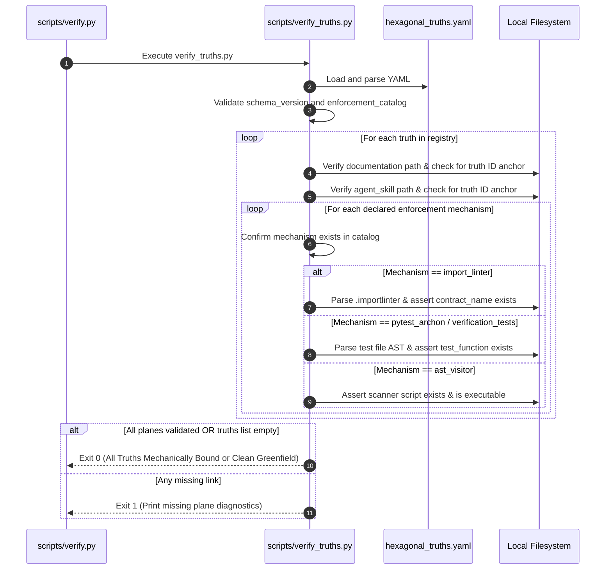

# SDD-0002: Hexagonal Truths Registry and Deterministic Multi-Mechanism Validator

## 1. Architectural Context & System Objectives

### 1.1 The Skeptic Test (Justification)
Why create a custom YAML registry and validation runner instead of standard pytest suites?
* **Multi-Plane Completeness:** Pytest asserts code behavior, but cannot verify whether human operator manuals (`docs/`) or LLM agent directives (`.gemini/rules/`) accurately reflect the active architectural rules.
* **Traceability Across Tools:** Hexagonal rules span disparate tools (`import-linter`, `pytest-archon`, custom AST scripts, reflection helpers). Without a single authoritative manifest, there is no way to audit whether an architectural invariant is partially implemented or missing critical gates.
* **Automated Truth Enforcement:** The Hexagonal Truths Registry ensures that every design truth is mechanically bound to its documentation, agent directives, and multi-tool enforcement gates.

### 1.2 The Vacation Test (Autonomy Specification)
This document provides complete, unabridged technical specifications for:
1. The exact YAML schema for `architecture/rules/hexagonal_truths.yaml`.
2. The 5-tool enforcement capability catalog.
3. The implementation of `scripts/verify_truths.py` verifying file presence, AST function existence, and string anchors.
4. Integration into the Upstream verification pipeline and downstream template payload.

---

## 2. Static Architectural Structure

### 2.1 Component Interaction Model

```mermaid
graph TD
    Registry["architecture/rules/hexagonal_truths.yaml<br/>(Catalog & Truth Bindings)"]
    Validator["scripts/verify_truths.py<br/>(Deterministic Registry Validator)"]

    subgraph Plane 1: Enforcement ["Plane 1: Enforcement Gates"]
        ImportLinter[".importlinter contracts"]
        Archon["pytest-archon test rules"]
        ASTLinter["AST visitor scripts"]
        Reflection["Runtime reflection helpers"]
        MypyStrict["mypy strict typing"]
    end

    subgraph Plane 2: Documentation ["Plane 2: Operator Docs"]
        DiataxisDocs["template/docs/reference/hexagonal_rules.md"]
    end

    subgraph Plane 3: LLM Skills ["Plane 3: Agent Directives"]
        GeminiRules["template/.gemini/rules/hexagonal_invariants.md"]
    end

    subgraph Plane 4: Tests ["Plane 4: Compliance Tests"]
        TestSuites["template/tests/architecture/*.py"]
    end

    Validator -->|Reads & Parses| Registry
    Validator -->|Asserts Contracts| Plane 1: Enforcement
    Validator -->|Asserts Anchors| DiataxisDocs
    Validator -->|Asserts Directives| GeminiRules
    Validator -->|Parses AST Functions| TestSuites
```

### 2.2 YAML Registry Schema (`architecture/rules/hexagonal_truths.yaml`)

```yaml
schema_version: "1.0"

enforcement_catalog:
  import_linter:
    description: "Static import graph contracts via .importlinter"
    config_file: "template/.importlinter"
  pytest_archon:
    description: "Fluent architectural layer assertion tests"
    test_dir: "template/tests/architecture"
  ast_visitor:
    description: "AST visitor script detecting unauthorized syntax or calls"
    script_dir: "template/scripts"
  runtime_reflection:
    description: "Runtime boundary introspection eliminating object tunneling"
    helper_path: "template/tests/helpers/boundary_reflection.py"
  strict_typing:
    description: "Mypy strict structural subtyping and protocol compliance"
    config_file: "template/pyproject.toml.jinja"

truths:
  - id: "HEXA-TRUTH-01"
    name: "Pure Core Domain Isolation"
    summary: "The core domain must never import external infrastructure, databases, or frameworks."
    enforcements:
      - mechanism: "import_linter"
        contract_name: "core_domain_isolation"
      - mechanism: "pytest_archon"
        test_file: "template/tests/architecture/test_boundaries.py"
        test_function: "test_core_domain_has_zero_external_dependencies"
    documentation:
      path: "template/docs/reference/hexagonal_rules.md"
      anchor: "HEXA-TRUTH-01"
    agent_skill:
      path: "template/.gemini/rules/hexagonal_invariants.md"
      anchor: "HEXA-TRUTH-01"
    verification_tests:
      - path: "template/tests/architecture/test_boundaries.py"
        test_function: "test_core_domain_has_zero_external_dependencies"
```

---

## 3. Dynamic Execution & Verification Flow



---

## 4. Implementation Specifications

### 4.1 Validator Implementation (`scripts/verify_truths.py`)
A standalone Python script executing standard AST and file introspection with empty-state tolerance:

```python
#!/usr/bin/env python3
"""Deterministic Hexagonal Truths Registry Validator."""
from __future__ import annotations

import ast
import sys
from pathlib import Path
import yaml

REPO_ROOT = Path(__file__).resolve().parent.parent
REGISTRY_PATH = REPO_ROOT / "architecture" / "rules" / "hexagonal_truths.yaml"

def validate_truth_chain() -> int:
    if not REGISTRY_PATH.is_file():
        print(f"[ERROR] Registry file missing: {REGISTRY_PATH}")
        return 1

    data = yaml.safe_load(REGISTRY_PATH.read_text(encoding="utf-8"))
    catalog = data.get("enforcement_catalog", {})
    truths = data.get("truths", [])

    if not truths:
        print("[INFO] Registry truths list is empty (clean greenfield state). Validation passed.")
        return 0

    errors: list[str] = []

    for t in truths:
        tid = t["id"]
        # Plane 1: Enforcements list
        enforcements = t.get("enforcements", [])
        if not enforcements:
            errors.append(f"{tid}: Must declare at least one enforcement mechanism.")

        for enf in enforcements:
            mech = enf["mechanism"]
            if mech not in catalog:
                errors.append(f"{tid}: Unknown mechanism '{mech}' not in catalog.")

        # Plane 2: Documentation check
        doc_path = REPO_ROOT / t["documentation"]["path"]
        if not doc_path.is_file():
            errors.append(f"{tid}: Missing documentation file {t['documentation']['path']}")
        elif t["documentation"]["anchor"] not in doc_path.read_text(encoding="utf-8"):
            errors.append(f"{tid}: Documentation missing anchor '{t['documentation']['anchor']}'")

        # Plane 3: Agent Directive check
        rule_path = REPO_ROOT / t["agent_skill"]["path"]
        if not rule_path.is_file():
            errors.append(f"{tid}: Missing agent rule file {t['agent_skill']['path']}")
        elif t["agent_skill"]["anchor"] not in rule_path.read_text(encoding="utf-8"):
            errors.append(f"{tid}: Agent rule missing anchor '{t['agent_skill']['anchor']}'")

        # Plane 4: Test AST check
        for vt in t.get("verification_tests", []):
            test_path = REPO_ROOT / vt["path"]
            if not test_path.is_file():
                errors.append(f"{tid}: Missing test file {vt['path']}")
            else:
                tree = ast.parse(test_path.read_text(encoding="utf-8"), filename=str(test_path))
                funcs = {n.name for n in ast.walk(tree) if isinstance(n, ast.FunctionDef)}
                if vt["test_function"] not in funcs:
                    errors.append(f"{tid}: Test function '{vt['test_function']}' not found in {vt['path']}")

    if errors:
        print("\n".join(f"[VIOLATION] {e}" for e in errors))
        return 1

    print(f"Verified {len(truths)} Hexagonal Truths across all 4 planes.")
    return 0

if __name__ == "__main__":
    sys.exit(validate_truth_chain())
```

### 4.2 Dual-Gate Pipeline Wiring & Empty-State Tolerance
To ensure no architectural invariants are added or altered without quad-plane backing, `verify_truths.py` is wired into two distinct quality gates:
1. **Pre-Commit Hook (`.pre-commit-config.yaml`):** Configured as a local pre-commit hook targeting `architecture/rules/hexagonal_truths.yaml` and related paths, running prior to commit creation.
2. **CI Prerequisite Gate 0 (`scripts/verify.py` & `.github/workflows/ci.yml`):** Wired as Gate 0 in `scripts/verify.py`, executing before linting or unit tests.
3. **Empty-State Tolerance:** When `truths: []` is empty, `verify_truths.py` outputs a clean pass (exit code 0). Unrelated PRs (e.g. documentation, CI configuration, template scaffolding) are never blocked by the validator.

### 4.3 Dependency Onboarding & Tooling Deployment
Dependency management spans both the template payload and the upstream harness:
* **Downstream Template Payload (`template/pyproject.toml.jinja`):**
  * `import-linter>=2.1`: Deployed in `dev` optional-dependencies for import graph enforcement.
  * `pytest-archon>=0.0.6`: Deployed in `dev` optional-dependencies for layer isolation testing.
  * `mypy>=1.13.0`: Deployed in `dev` optional-dependencies for static structural typing.
  * `ast_visitor` & `runtime_reflection`: Implemented via Python standard library (`ast`, `inspect`, `typing`), introducing zero third-party dependencies.
* **Upstream Quality Harness (`pyproject.toml` & `.github/workflows/ci.yml`):**
  * `pyyaml>=6.0.2`: Added to `[project.optional-dependencies] dev` and the GitHub Actions CI workflow to support parsing and validating `hexagonal_truths.yaml` within `scripts/verify_truths.py`.

### 4.4 Upstream Agent Workflow Skill (`.gemini/skills/hexagonal-truth-authoring/`)
To eliminate LLM alignment drift and guarantee full realization of every newly declared truth, the Upstream environment equips coding assistants with a dedicated Antigravity skill:
* **Trigger Directive:** `.gemini/rules/hexagonal_truth_governance.md` routes any request regarding adding or modifying architectural truths to `.gemini/skills/hexagonal-truth-authoring/SKILL.md`.
* **Execution Flow:** The skill mandates a 5-phase sequential playbook:
  1. **Phase 1 (Inception & Catalog Selection):** Assign sequential `HEXA-TRUTH-NN` ID and choose tools from the 5-tool catalog.
  2. **Phase 2 (Quad-Plane Lockstep Authoring):** Generate linter contract, user documentation (`template/docs/reference/`), agent rule (`template/.gemini/rules/`), and compliance tests (`template/tests/architecture/`).
  3. **Phase 3 (Registry Binding):** Append record to `architecture/rules/hexagonal_truths.yaml`.
  4. **Phase 4 (Deterministic Verification):** Execute `scripts/verify_truths.py` and `scripts/verify.py` asserting exit code 0.
  5. **Phase 5 (Git & PR):** Commit, push, and open Pull Request.

### 4.4 Upstream Versioning & Release Governance Proviso
Execution of `bump-my-version` in the Upstream repository is strictly relegated to the `main` branch:
* **Feature & Architectural Branches:** Version bumps and git release tags are strictly prohibited on working branches (e.g. `docs/`, `feat/`, `fix/`).
* **Release Cadence:** `bump-my-version bump [patch|minor|major]` must be invoked exclusively after pull requests are merged into `main` and verified by upstream CI.

---

## 5. Phased Implementation Plan

- [ ] **Phase 1: Registry Foundation:** Create `architecture/rules/hexagonal_truths.yaml` defining the 5-tool catalog and initial truths (`HEXA-TRUTH-01` through `HEXA-TRUTH-05`).
- [ ] **Phase 2: Validator Runner & Dual-Gate Wiring:** Implement `scripts/verify_truths.py` with empty-state tolerance and wire into `scripts/verify.py` and `.pre-commit-config.yaml`.
- [ ] **Phase 3: Payload Integration:** Provide initial starter documents (`template/docs/reference/hexagonal_rules.md`, `template/.gemini/rules/hexagonal_invariants.md`, and `template/tests/architecture/test_boundaries.py`).
- [ ] **Phase 4: CI Verification & Push:** Run `scripts/verify.py` locally and in GitHub Actions CI to assert 100% compliance.
- [ ] **Phase 5: Release on Main:** Execute `bump-my-version` exclusively on `main` following PR merge.
