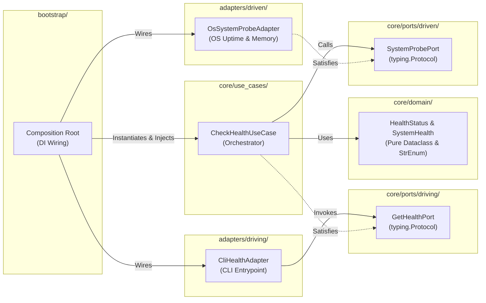

# SDD-0003: Health Service Walking Skeleton Component Design

## 1. Architectural Context & System Objectives

### 1.1 The Skeptic Test (Justification)
Why implement a System Health Walking Skeleton in a generic Python Hexagonal template?
* **Elimination of Artificial Scaffolding:** Traditional templates ship with dummy classes (`DummyService`, `MockAdapter`) or sample domains (`Todo`, `Library`) that downstream developers delete immediately, instantly breaking day-one linting and tests.
* **Universal Production Requirement:** Every containerized daemon, microservice, and CLI application requires health, liveness, and uptime reporting. Shipping a pure Hexagonal Health Service gives the user an indispensable production feature from day one.
* **Authentic Boundary Verification:** Static architectural linters (`import-linter`, `pytest-archon`, `mypy`) require concrete modules and import graphs to traverse. The Health Service provides a minimal, complete hexagonal slice across all layers of Topology A.

### 1.2 The Vacation Test (Autonomy Specification)
This document specifies the exact component contracts, package layout, and incremental construction strategy for the Health Service. Downstream engineers and coding agents can reference this specification to construct the walking skeleton without ambiguity.

---

## 2. Static Architectural Structure

### 2.1 Component Interaction Model

### 2.2 Component Specifications

#### A. Domain (`template/src/{{package_name}}/core/domain/health.py`)
* **`HealthStatus` (StrEnum):** `HEALTHY`, `DEGRADED`, `UNHEALTHY`.
* **`SystemHealth` (Frozen Dataclass):**
  * `status: HealthStatus`
  * `service_name: str`
  * `timestamp: datetime`

#### B. Driving Port (`template/src/{{package_name}}/core/ports/driving/health_port.py`)
* **`GetHealthPort` (Protocol, `@runtime_checkable`):**
  * Method: `check_health() -> SystemHealth`

#### C. Driven Port (`template/src/{{package_name}}/core/ports/driven/probe_port.py`)
* **`SystemProbePort` (Protocol, `@runtime_checkable`):**
  * Method: `is_operational() -> bool`
  * Method: `get_probe_metadata() -> dict[str, str]`

#### D. Use Case (`template/src/{{package_name}}/core/use_cases/check_health.py`)
* **`CheckHealthUseCase`:**
  * Constructor: `__init__(self, probe: SystemProbePort, service_name: str)`
  * Executes probe, evaluates status, and returns immutable `SystemHealth` DTO.

#### E. Driven Adapter (`template/src/{{package_name}}/adapters/driven/system_probe.py`)
* **`OsSystemProbeAdapter`:**
  * Implements `SystemProbePort` structurally without importing third-party libraries (standard library `os`, `sys`, `platform`).

#### F. Driving Adapter (`template/src/{{package_name}}/adapters/driving/cli_health.py`)
* **`CliHealthAdapter`:**
  * Accepts `GetHealthPort` and outputs structured JSON or CLI exit codes (`0` for healthy, `1` for unhealthy).

---

## 3. Incremental Rollout Strategy

Per architectural directive, the Health Service files will **NOT** be generated in a single batch. Instead, they will be incrementally authored and verified in lockstep across upcoming `hexagonal_truths.yaml` PRs:

1. **Step 1 (DTO Purity & Port Integrity):**
   * Author `core/domain/health.py` and `core/ports/{driving,driven}/` alongside `HEXA-TRUTH-04` (DTO & Anti-Tunneling Boundary Purity).
2. **Step 2 (Lifecycle & Orchestration Isolation):**
   * Author `core/use_cases/check_health.py` and `adapters/driven/system_probe.py` alongside `HEXA-TRUTH-05` (Zero Lifecycle Pollution in Domain).
3. **Step 3 (Composition Root & End-to-End Execution):**
   * Author `adapters/driving/cli_health.py` and `bootstrap/container.py` alongside `HEXA-TRUTH-06` (Composition Root Isolation).

---

## 4. Verification & Testing Invariants

* **Positive Smoke Gate:** Instantiated template runs `pytest` and `lint-imports` against the Health Service slice and exits with code 0.
* **Negative Mutation Gate:** Upstream tests in `tests/test_truth_enforcement.py` inject mutations into `health.py` or `health_port.py` to prove that downstream gates block illegal dependencies.
