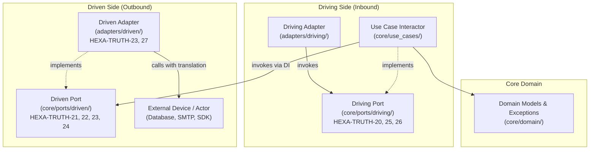

# SDD-0004: Directional Port Invariants and Enforcement Specification

## 1. Architectural Context & System Objectives

### 1.1 The Skeptic Test (Justification)
Why dedicate specific architectural rules and verification mechanisms to Driving vs. Driven Ports?
* **Opposing Control Flow Dynamics:** Driving ports are invoked *inward* by external drivers to run use cases; driven ports are invoked *outward* by use cases to query repositories or notify recipients. Treating them identically under a generic "Port" abstraction obscures directional failure modes.
* **The "Right Boundary" Principle (Garrido):** Secondary ports exist solely to talk to secondary external systems, not to model internal domain concepts. Enforcement ensures anti-corruption translation occurs inside the core application rather than leaking into external adapters.
* **Exception & Payload Leakage:** Without mechanical validation, external database drivers (`psycopg2`, `boto3`, `redis`) and transport contexts (`fastapi.Request`, `click.Context`) routinely leak across port boundaries into business interactors.

### 1.2 The Vacation Test (Autonomy Specification)
This document specifies the exact AST visitor checks, Import Linter contracts, typing constraints, and quad-plane manifest bindings for `HEXA-TRUTH-20` through `HEXA-TRUTH-27`. Downstream developers and autonomous coding agents can implement these invariants without ambiguity.

---

## 2. Static Architectural Structure & Rule Invariants

---

## 3. Detailed Rule Invariant Blueprints

### 3.1 HEXA-TRUTH-20: Driving Port Directional Integrity & Use Case Exclusivity
* **Definition:** Driving port contracts must reside strictly in `core/ports/driving/`, inherit from `DrivingPort` (Level 1 marker), and be implemented exclusively by application use cases in `core/use_cases/`. Adapters (`adapters/`) must never implement driving ports.
* **AST Visitor Enforcement:**
  * Scan all classes in `core/ports/driving/*.py`.
  * Verify `node.bases` contains `DrivingPort`.
  * Scan all classes in `adapters/**/*.py`. Assert no adapter class inherits from a `DrivingPort` or class defined in `core/ports/driving/`.

### 3.2 HEXA-TRUTH-21: Driven Port Inversion & Injection Governance
* **Definition:** Driven port contracts must reside strictly in `core/ports/driven/`, inherit from `DrivenPort` (Level 1 marker), and be implemented exclusively by external driven adapters in `adapters/driven/`. Use cases must never implement driven ports and must declare them strictly via constructor dependency injection (`__init__`).
* **AST Visitor Enforcement:**
  * Scan all classes in `core/ports/driven/*.py`.
  * Verify `node.bases` contains `DrivenPort`.
  * Scan all classes in `core/use_cases/*.py`. Assert no use case inherits from a `DrivenPort`. Assert that every use case `__init__` contains at least one parameter typed with a driven port protocol.

### 3.3 HEXA-TRUTH-22: Repository vs. Recipient Driven Port Semantics
* **Definition:** Driven ports must reflect clear secondary actor semantics:
  * **Repository Port:** Manages persistence/retrieval for a domain concept; methods return domain models, optional entities, or collections.
  * **Recipient Port:** Delivers notifications or events to external systems; methods return `None` or an acknowledgment scalar.
  * Driven ports must not conflate notification side effects with state persistence across a single monolithic interface.
* **AST / Typing Enforcement:**
  * Validate that port method return annotations are either domain entities/DTOs (for repositories) or `None`/`bool` (for recipients).

### 3.4 HEXA-TRUTH-23: Outbound Infrastructure Exception Masking
* **Definition:** Driven adapters must catch external vendor, network, or OS exceptions and translate them into pure domain-level port exceptions (`ProbeExecutionError`, `RepositoryError`). Vendor exceptions (`psycopg2.Error`, `redis.RedisError`, `OSError`) must never bubble unhandled into the core application.
* **AST Visitor Enforcement:**
  * Scan methods in `adapters/driven/*.py`.
  * Ensure methods calling external libraries enclose calls within `try...except` blocks and re-raise using domain exceptions inheriting from `DomainError` or `PortError`.

### 3.5 HEXA-TRUTH-24: Driven Port Return Type Encapsulation
* **Definition:** Driven port method signatures must strictly return pure domain entities, value objects, or frozen DTOs. They must never return ORM models, querysets, raw database cursors, HTTP responses, or untyped dictionaries.
* **AST Visitor Enforcement:**
  * Inspect `returns` annotations on `ast.FunctionDef` in `core/ports/driven/*.py`.
  * Disallow forbidden types: `dict`, `Dict`, `Cursor`, `QuerySet`, `Response`, `Any`.

### 3.6 HEXA-TRUTH-25: Driving Port CQRS & Use Case Cohesion
* **Definition:** Driving ports represent single application capabilities or CQRS operations. They must never expose persistence-oriented CRUD verbs (`find_by_id`, `delete`, `update_row`, `save`).
* **AST Visitor Enforcement:**
  * Inspect function names in `core/ports/driving/*.py`.
  * Forbid persistence primitives (`save`, `delete`, `find_by_id`, `insert`). Require intent-revealing business verbs (`check`, `get`, `register`, `process`, `calculate`).

### 3.7 HEXA-TRUTH-26: Caller & Transport Ignorance
* **Definition:** Driving port method parameters must never accept transport-specific objects (`Request`, `Response`, `Header`, `Session`, `CliContext`). All parameters must be primitive scalars, value objects, or frozen input DTOs.
* **AST Visitor Enforcement:**
  * Inspect parameter annotations in `core/ports/driving/*.py`.
  * Ensure zero imports or annotations referencing web, CLI, or transport types.

### 3.8 HEXA-TRUTH-27: Dual-Adapter Test Double Parity
* **Definition:** For every driven port declared in `core/ports/driven/`, downstream test suites must maintain an in-memory test double (stub or fake) implementing the port contract to allow full testability in isolation from real infrastructure.
* **AST / Test Suite Enforcement:**
  * Verify that for each port in `core/ports/driven/`, a matching test double exists in `tests/test_doubles/` or `tests/mocks/` satisfying the port protocol.

---

## 4. Rollout Strategy & Phasing

Implementation of `HEXA-TRUTH-20` through `HEXA-TRUTH-27` will proceed across dedicated, isolated feature branches:
* **Batch 1 (Structural Directional Integrity):** `HEXA-TRUTH-20` (Driving Port Exclusivity) and `HEXA-TRUTH-21` (Driven Port Inversion).
* **Batch 2 (Boundary Defense & Payload Encapsulation):** `HEXA-TRUTH-23` (Exception Masking), `HEXA-TRUTH-24` (Return Encapsulation), and `HEXA-TRUTH-26` (Transport Ignorance).
* **Batch 3 (Domain Semantics & Testability Parity):** `HEXA-TRUTH-22` (Repository vs Recipient), `HEXA-TRUTH-25` (CQRS Cohesion), and `HEXA-TRUTH-27` (Test Double Parity).
