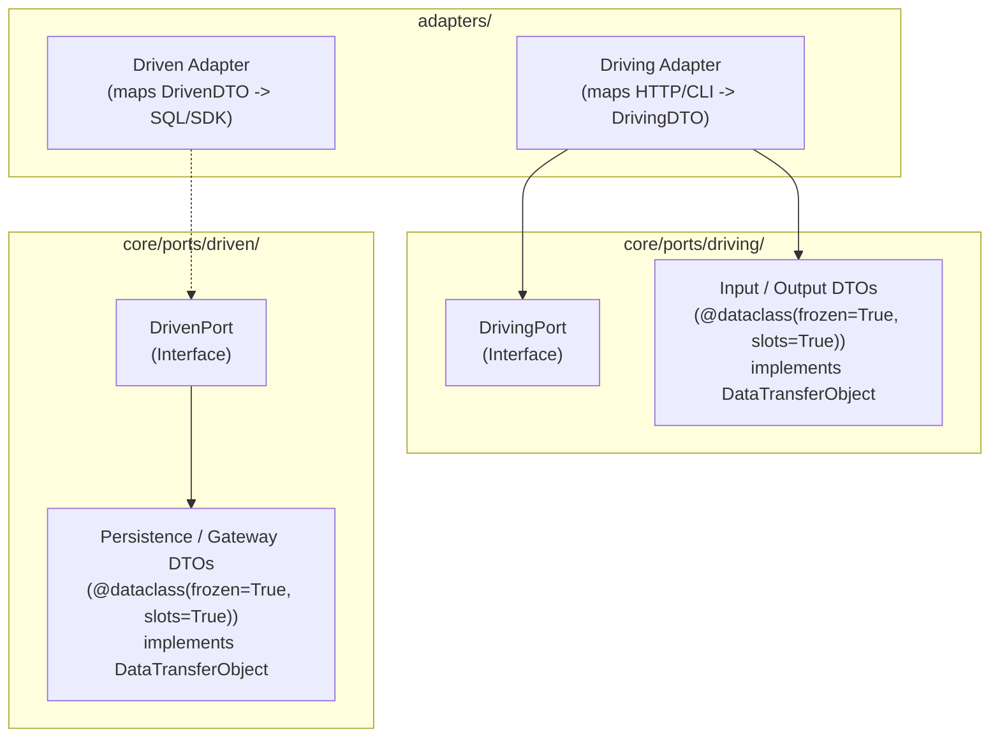

# SDD-0005: Data Transfer Object Specification and Mechanical Enforcement

## 1. Architectural Context & System Objectives

### 1.1 The Skeptic Test (Justification)
Why enforce structural constraints on Data Transfer Objects (DTOs)?
* **Boundary Purity:** In Hexagonal Architecture, DTOs define the shape of information traveling across the port membrane. Without automated governance, mutable dictionaries or framework request objects leak across boundaries, eroding decoupling.
* **Thread-Safety & Determinism:** Mutable objects passed into asynchronous event loops or background tasks cause race conditions. Enforcing `@dataclass(frozen=True, slots=True)` guarantees thread safety by design.
* **Explicit Ownership:** DTOs represent the core application's data contract. Placing them in `core/ports/` prevents accidental backward dependencies from ports to outer adapters.

### 1.2 The Vacation Test (Autonomy Specification)
This document specifies the exact AST visitor checks, marker protocol definitions, topological layout rules, and quad-plane manifest bindings for DTO governance (`HEXA-TRUTH-28`). Downstream developers and autonomous coding agents can implement these specifications without ambiguity.

---

## 2. Static Architectural Structure & Taxonomy

---

## 3. Technical Invariants & Mechanical Enforcement

### 3.1 HEXA-TRUTH-28: DTO Immutability & Structural Purity
* **Summary:** Data Transfer Objects defined in `core/ports/` must be decorated with `@dataclass(frozen=True)` (or inherit `DataTransferObject`), contain type-annotated fields composed strictly of primitives, frozen DTOs, or domain value objects, and contain zero executable business methods.
* **AST Visitor Specifications:**
  1. **Topological Location Invariant:**
     * Inspect all modules in `adapters/` and `core/domain/`.
     * Assert that zero classes are defined with name suffixes `DTO`, `Command`, `Query` or inherit from `DataTransferObject`.
  2. **Decorator Invariant:**
     * Inspect all classes defined in `core/ports/**/dtos.py` or classes named with suffix `DTO` / `Command` / `Query`.
     * Assert that the class is decorated with `@dataclass(frozen=True)` or `@dataclass(frozen=True, slots=True)`.
  3. **Immutability Invariant:**
     * Assert that DTO field types are not mutable primitives (`list`, `dict`, `set`). Allowed alternatives are `tuple`, `frozenset`, or frozen nested DTOs.
  4. **Method Restriction Invariant:**
     * Assert that DTO classes contain only `__init__`, `__post_init__`, or property getters. Business calculation methods and side-effecting operations are strictly forbidden.
  5. **Prohibited Type Blacklist:**
     * Field type annotations must not reference:
       * ORM base classes (`Base`, `Model`, `SQLModel`).
       * Web/Transport frameworks (`Request`, `Response`, `UploadFile`, `Context`).
       * Database drivers (`Cursor`, `Session`, `Connection`).

---

## 4. Implementation Phasing

1. **Step 1: Protocol & Starter Artifacts:**
   * Add `DataTransferObject` protocol to `template/src/{{package_name}}/core/ports/base.py`.
   * Register `HEXA-TRUTH-28` in `architecture/rules/hexagonal_truths.yaml`.
2. **Step 2: AST Gate & Test Enforcement:**
   * Add `test_dto_immutability_and_structural_purity` to `template/tests/architecture/test_boundaries.py`.
   * Add negative mutation tests in `tests/test_truth_enforcement.py`.
3. **Step 3: Reference Documentation & Agent Directives:**
   * Update `template/docs/reference/hexagonal_rules.md` and `template/.gemini/rules/hexagonal_invariants.md`.
