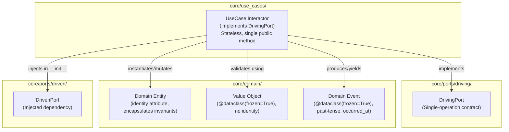

# SDD-0006: Core Domain and Use Case Interactor Governance Specification

## 1. Architectural Context & System Objectives

### 1.1 The Skeptic Test (Justification)
Why enforce structural constraints on `core/domain/` and `core/use_cases/`?
* **Domain Model Integrity:** Without structural governance, domain entities degenerate into passive DTOs, pushing invariant validation into procedural script-like use cases.
* **Single Responsibility & CQRS Cohesion:** Grouping multiple unrelated business actions into large "Service" classes makes codebases difficult to refactor, test, and maintain. Single-entry interactors guarantee isolated unit testing and clear execution traces.
* **Concurrency & Reentrancy Safety:** State retained on interactor instances creates data corruption and race conditions in concurrent execution environments (ASGI event loops, Celery worker threads).

### 1.2 The Vacation Test (Autonomy Specification)
This document specifies the exact AST visitor checks, structural patterns, and quad-plane manifest bindings for `HEXA-TRUTH-29` through `HEXA-TRUTH-33`. Downstream developers and autonomous coding agents can implement these specifications without ambiguity.

---

## 2. Static Architectural Structure & Taxonomy

---

## 3. Technical Invariants & Mechanical Enforcement Specifications

### 3.1 HEXA-TRUTH-29: Domain Entity Identity & Value Object Immutability (`core/domain/`)
* **Specification:**
  1. Classes defined in `core/domain/` that represent Value Objects must be decorated with `@dataclass(frozen=True)`.
  2. Classes representing Domain Entities must define an identity attribute (e.g., `id`, `uuid`, `entity_id`) and contain business invariant validation (e.g. in `__post_init__`).
* **AST Enforcement:**
  * Scan classes in `core/domain/*.py` (excluding `exceptions.py` and `__init__.py`).
  * Verify that dataclasses without an identity attribute are explicitly declared frozen (`frozen=True`).

### 3.2 HEXA-TRUTH-30: Pure Domain Events Specification (`core/domain/`)
* **Specification:**
  1. Domain event classes must end with suffix `Event` or be named in past tense (e.g. `UserCreated`, `HealthChecked`).
  2. Must be decorated with `@dataclass(frozen=True)`.
  3. Must contain `occurred_at` (or `timestamp`) and unique identifier fields.
  4. Forbidden from containing network or message bus protocol attributes (e.g. `routing_key`, `topic`, `delivery_tag`).

### 3.3 HEXA-TRUTH-31: Single-Operation Use Case Interactor Cohesion (`core/use_cases/`)
* **Specification:**
  1. Use case interactor classes in `core/use_cases/` must implement a single Driving Port interface.
  2. Use case classes must expose **at most one public execution method** (excluding `__init__` and private helper methods `_*`).
  3. Prohibits multi-method "Service" classes (e.g., `create_user()`, `delete_user()`, `list_users()` on a single class).
* **AST Enforcement:**
  * Scan all classes in `core/use_cases/*.py`.
  * Count public `ast.FunctionDef` nodes in class body. Assert count == 1.

### 3.4 HEXA-TRUTH-32: Stateless Use Case Interactor Lifecycle (`core/use_cases/`)
* **Specification:**
  1. Use case instance attributes initialized in `__init__` must be strictly limited to driven port dependencies or immutable configuration.
  2. Public execution methods must not mutate instance state (`self.x = ...`).
* **AST Enforcement:**
  * Scan AST of all public methods in `core/use_cases/*.py`.
  * Assert zero `ast.Assign` or `ast.AugAssign` targets referencing `self.<var>`.

### 3.5 HEXA-TRUTH-33: Domain Exception Exclusivity in Use Case Signatures (`core/use_cases/`)
* **Specification:**
  1. Use cases must never directly raise generic Python standard exceptions (`Exception`, `RuntimeError`, `KeyError`, `ValueError`) as business outcomes.
  2. Any explicitly raised exception must inherit from `DomainError` in `core.domain.exceptions`.
* **AST Enforcement:**
  * Inspect `ast.Raise` nodes within `core/use_cases/*.py`.
  * Assert that raised exceptions resolve to domain error types.

---

## 4. Implementation Phasing

1. **Step 1: ADR & SDD Adoption (Docs PR):**
   * Review and merge ADR 0006 and SDD-0006 establishing the governance standard for `core/domain/` and `core/use_cases/`.
2. **Step 2: Manifest & Quad-Plane Registration (Feature Branch):**
   * Register `HEXA-TRUTH-29` through `HEXA-TRUTH-33` in `architecture/rules/hexagonal_truths.yaml`.
   * Update reference documentation and agent invariants skill.
3. **Step 3: Test Implementation & Negative Mutation Verification:**
   * Implement automated AST enforcement tests in `template/tests/architecture/test_boundaries.py`.
   * Add negative mutation verification tests in `tests/test_truth_enforcement.py`.
4. **Step 4: Quality Gate Run & Push:**
   * Verify all 33 truths via `scripts/verify.py` and submit PR for implementation.
